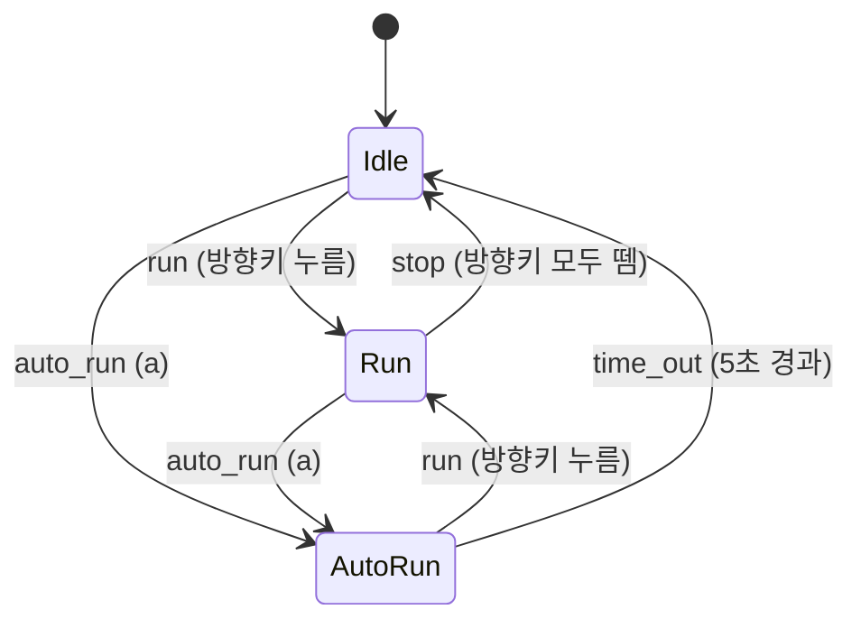

# Boy on the Grass — 개발 문서

잔디(Grass) 위에서 소년이 서 있거나(Idle), 방향키로 달리거나(Run), `a` 키로 5초 동안 크게 커져서 혼자 좌우로 달리는(AutoRun) 2D 게임.

---

## 1. 요구사항

| ID | 내용 |
|----|------|
| R1 | 소년의 상태는 **Idle**, **Run**, **AutoRun** 세 가지다. |
| R2 | 입력이 없으면 **Idle** 상태를 유지하고 Idle 애니메이션을 재생한다. |
| R3 | `a` 키를 누르면 **AutoRun** 상태가 되고, 키 조작 없이 혼자 좌우로 움직인다. |
| R4 | AutoRun 상태에서는 소년이 **확대**되어 그려지고, Run보다 **빠르게** 움직인다. |
| R5 | AutoRun은 **5초** 동안 지속되며, 시간이 지나면 **Idle**로 돌아간다. |
| R6 | AutoRun은 **별도의 상태 클래스**(`AutoRun`)로 구현한다. |
| R7 | 좌/우 방향키를 누르면 **Run** 상태가 되고 그 방향으로 움직인다. |
| R8 | AutoRun 중에 좌/우 방향키를 누르면 AutoRun이 풀리고 **Run** 상태로 바뀌어 움직인다. |
| R9 | `main.py`, `Boy.py`, `Grass.py`처럼 **클래스마다 모듈 파일을 나눈다**. |
| R10 | 소년 스프라이트는 `animation_sheet.png`, 배경은 `grass.png`를 쓴다. |
| R11 | `pico2d`와 `from transitions import Machine`을 사용한다. |
| R12 | 기능 단위로 조금씩 개발하고, 단계마다 커밋을 남긴다. |

---

## 2. 개발 환경

| 항목 | 내용 |
|------|------|
| 언어 | Python 3 |
| 그래픽 / 입력 | `pico2d` |
| 상태 머신 | `transitions` (`from transitions import Machine`), 0.9.x 버전에서 확인 |
| 실행 | `python main.py` |

```bash
pip install pico2d transitions
```

---

## 3. 파일 구성

```
2020180012_2DGP_test2/
├── main.py              # 게임 루프: 열기 → 이벤트 처리 → 갱신 → 그리기 → 닫기
├── Boy.py               # Boy 클래스, 상태 클래스(Idle, Run, AutoRun), 상태 머신
├── Grass.py             # Grass 클래스 (배경)
├── animation_sheet.png  # 소년 스프라이트 시트
├── grass.png            # 잔디 이미지
└── DEVELOPMENT.md       # 이 문서
```

모듈 의존 관계: `main.py` → `Boy.py`, `Grass.py` → `pico2d`.
`Boy.py`는 추가로 `transitions`를 사용한다.

---

## 4. 리소스 명세

### 4.1 `animation_sheet.png` (800 × 400)

한 프레임은 **100 × 100**이고, 한 줄에 **8 프레임**씩 **4줄**이 있다.
pico2d의 `clip_draw`는 **왼쪽 아래**를 원점으로 쓰므로 `bottom` 값은 아래 표와 같다.

| 이미지상 줄 (위에서부터) | 동작 | `clip_draw` bottom | `action` 값 |
|---------------|------|--------------------|-------------|
| 1 | Idle, 오른쪽 | 300 | 3 |
| 2 | Idle, 왼쪽 | 200 | 2 |
| 3 | Run, 오른쪽 | 100 | 1 |
| 4 | Run, 왼쪽 | 0 | 0 |

```python
self.image.clip_draw(self.frame * 100, self.action * 100, 100, 100, self.x, self.y)
```

### 4.2 `grass.png` (800 × 30)

캔버스 아래쪽에 그린다: `self.image.draw(400, 30)`.

---

## 5. 화면과 상수

| 이름 | 값 | 설명 |
|------|----|------|
| `CANVAS_WIDTH`, `CANVAS_HEIGHT` | 800, 600 | 창 크기 |
| `GROUND_Y` | 90 | 일반 크기 소년의 중심 y (발이 잔디 위에 닿는 높이) |
| `FRAME_COUNT` | 8 | 동작 하나의 애니메이션 프레임 수 |
| `RUN_SPEED` | 5 | Run 이동 속도 (픽셀/프레임) |
| `AUTO_RUN_SPEED` | 10 | AutoRun 이동 속도 (픽셀/프레임), Run의 **2배** |
| `AUTO_RUN_SCALE` | 2 | AutoRun에서 그리는 배율 (100 → 200 픽셀) |
| `AUTO_RUN_DURATION` | 5.0 | AutoRun 지속 시간 (초) |
| `FRAME_DELAY` | 0.01 ~ 0.05 | 프레임 사이 `delay()` 값, 애니메이션 속도를 보고 조절 |

> AutoRun에서 크기가 2배가 되면, 발이 잔디 위에 그대로 있도록 그리는 y를 `GROUND_Y + 50`으로 올린다.

---

## 6. 상태 머신 설계

### 6.1 상태 전이도



### 6.2 전이 표

| 현재 상태 | 트리거 | 다음 상태 | 발생 조건 |
|-----------|--------|-----------|-----------|
| Idle | `run` | Run | 방향키를 눌러 `dir != 0`이 됨 |
| Idle | `auto_run` | AutoRun | `a` 누름 |
| Run | `stop` | Idle | 방향키를 모두 떼서 `dir == 0`이 됨 |
| Run | `auto_run` | AutoRun | `a` 누름 |
| AutoRun | `run` | Run | AutoRun 중에 방향키를 **누름** |
| AutoRun | `time_out` | Idle | `get_time() - start_time >= 5.0` |

표에 없는 상태/트리거 조합은 `ignore_invalid_triggers=True`로 **무시**한다. 예를 들면:
- AutoRun 중에 방향키를 **떼는** 것(`stop`)은 무시된다. AutoRun을 끝낼 수 있는 것은 키를 누르는 것과 시간 초과뿐이다.
- AutoRun 중에 `a`를 다시 누르는 것은 무시된다. 타이머는 다시 시작되지 않는다.
- Idle/Run에서 발생한 `time_out`은 무시된다.

### 6.3 키 입력을 트리거로 바꾸기

방향은 키를 누르거나 뗄 때마다 누적되는 값 `dir`로 관리한다 (`-1`, `0`, `+1`). 이렇게 하면 왼쪽과 오른쪽을 동시에 누를 때도 결과가 맞는다.

| pico2d 이벤트 | `dir` 변화 | 이후 호출 |
|---------------|------------|-----------|
| `SDL_KEYDOWN`, `SDLK_RIGHT` | `+1` | `run()` (dir ≠ 0일 때) / `stop()` (dir == 0일 때) |
| `SDL_KEYDOWN`, `SDLK_LEFT` | `-1` | 위와 같음 |
| `SDL_KEYUP`, `SDLK_RIGHT` | `-1` | 위와 같음 (AutoRun에서는 **키를 뗀 것**이므로 `run`을 호출하지 않음) |
| `SDL_KEYUP`, `SDLK_LEFT` | `+1` | 위와 같음 |
| `SDL_KEYDOWN`, `SDLK_a` | — | `auto_run()` |

R8 규칙("AutoRun 중 방향키 **입력** 시 Run으로 전환")은 **KEYDOWN**에서만 `run()`을 보내는 것으로 지킨다. 이전에 누르고 있던 키를 AutoRun 도중에 떼더라도 상태가 바뀌지 않는다.

---

## 7. 클래스 설계

### 7.1 상태 클래스 (`Boy.py`)

모든 상태 클래스는 같은 형태의 정적 메서드를 갖는다. 매개변수로 `boy`를 받아서 소년의 데이터를 읽고 쓴다.

| 메서드 | 역할 |
|--------|------|
| `enter(boy)` | 상태에 들어갈 때 한 번 실행 (`action`, 속도, 타이머 등 초기화) |
| `exit(boy)` | 상태에서 나갈 때 한 번 실행 |
| `do(boy)` | 매 프레임 실행 (애니메이션 프레임 증가, 위치 이동, 시간 확인) |
| `draw(boy)` | 매 프레임 그리기 |

#### `Idle`
- **enter**: `face_dir`에 맞춰 `action`을 3(오른쪽)이나 2(왼쪽)으로 정한다. `frame = 0`.
- **do**: `frame = (frame + 1) % 8`.
- **draw**: 100×100, `(x, GROUND_Y)`에 그린다.

#### `Run`
- **enter**: `face_dir = dir`로 하고, `action`을 1(오른쪽)이나 0(왼쪽)으로 정한다.
- **do**: 프레임을 증가시키고 `x += dir * RUN_SPEED`. x는 `[50, 750]` 범위로 제한한다. 달리는 도중 방향이 바뀔 수 있으므로 `dir`에 맞춰 `face_dir`와 `action`도 매 프레임 갱신한다.
- **draw**: 100×100, `(x, GROUND_Y)`에 그린다.

#### `AutoRun` (R6에서 요구한 새 상태 클래스)
- **enter**: `start_time = get_time()`. 이동 방향 `auto_dir`는 `face_dir`로 시작하고, `action`을 그에 맞게 정한다.
- **do**:
  1. 프레임을 증가시킨다.
  2. `x += auto_dir * AUTO_RUN_SPEED`.
  3. 화면 끝(크기가 커졌으므로 `x <= 100` 또는 `x >= 700`)에 닿으면 `auto_dir`를 반대로 바꾸고 `action`/`face_dir`도 바꾼다. 이렇게 **혼자 좌우로 왕복**한다.
  4. `get_time() - start_time >= AUTO_RUN_DURATION`이면 `boy.time_out()`을 호출한다.
- **exit**: 끝날 때 바라보던 방향이 Idle/Run에 이어지도록 `face_dir = auto_dir`.
- **draw**: 200×200(2배), `(x, GROUND_Y + 50)`에 그린다.

```python
self.image.clip_draw(frame * 100, action * 100, 100, 100,
                     x, GROUND_Y + 50, 100 * AUTO_RUN_SCALE, 100 * AUTO_RUN_SCALE)
```

### 7.2 `Boy` 클래스

| 속성 | 설명 |
|------|------|
| `x` | 가로 위치 |
| `frame` | 현재 애니메이션 프레임 (0–7) |
| `action` | 스프라이트 시트의 줄 (0–3) |
| `dir` | 방향키로 누적된 입력 방향 (-1 / 0 / +1) |
| `face_dir` | 마지막으로 바라본 방향 (-1 / +1) |
| `auto_dir` | AutoRun에서 이동하는 방향 |
| `start_time` | AutoRun을 시작한 시각 |
| `image` | `load_image('animation_sheet.png')` |
| `state` | `transitions`가 넣어주는 현재 상태 이름 |

| 메서드 | 설명 |
|--------|------|
| `handle_event(event)` | 6.3절의 표대로 키 이벤트를 트리거로 바꾼다 |
| `update()` | `STATES[self.state].do(self)` |
| `draw()` | `STATES[self.state].draw(self)` |

#### `transitions.Machine` 연결

```python
from transitions import Machine

STATES = {'Idle': Idle, 'Run': Run, 'AutoRun': AutoRun}

TRANSITIONS = [
    {'trigger': 'run',      'source': ['Idle', 'AutoRun'], 'dest': 'Run'},
    {'trigger': 'stop',     'source': 'Run',               'dest': 'Idle'},
    {'trigger': 'auto_run', 'source': ['Idle', 'Run'],     'dest': 'AutoRun'},
    {'trigger': 'time_out', 'source': 'AutoRun',           'dest': 'Idle'},
]

class Boy:
    def __init__(self):
        ...
        self.machine = Machine(
            model=self,
            states=[{'name': name,
                     'on_enter': lambda n=name: STATES[n].enter(self),
                     'on_exit':  lambda n=name: STATES[n].exit(self)}
                    for name in STATES],
            transitions=TRANSITIONS,
            initial='Idle',
            ignore_invalid_triggers=True,
        )
        Idle.enter(self)   # 초기 상태에서는 on_enter가 실행되지 않으므로 직접 호출
```

> 주의: `transitions`는 **초기 상태**에 대해 `on_enter`를 호출하지 않는다. 그래서 생성자에서 `Idle.enter(self)`를 직접 호출한다.
> `Run → Run`처럼 같은 상태로 가는 전이는 정의하지 않는다. Run 도중 방향만 바뀌면 `dir`만 바뀌며, Run에 들어갈 때만 `action`을 정하는 대신 `Run.do`에서 `dir`에 맞춰 `action`과 `face_dir`를 매 프레임 갱신한다.

### 7.3 `Grass` 클래스 (`Grass.py`)

```python
from pico2d import load_image

class Grass:
    def __init__(self):
        self.image = load_image('grass.png')

    def update(self):
        pass

    def draw(self):
        self.image.draw(400, 30)
```

### 7.4 `main.py`

```python
from pico2d import *
from Grass import Grass
from Boy import Boy

def handle_events():
    global running
    for event in get_events():
        if event.type == SDL_QUIT:
            running = False
        elif event.type == SDL_KEYDOWN and event.key == SDLK_ESCAPE:
            running = False
        else:
            boy.handle_event(event)

def reset_world():
    global running, grass, boy, world
    running = True
    grass = Grass()
    boy = Boy()
    world = [grass, boy]

def update_world():
    for o in world:
        o.update()

def render_world():
    clear_canvas()
    for o in world:
        o.draw()
    update_canvas()

open_canvas(800, 600)
reset_world()
while running:
    handle_events()
    update_world()
    render_world()
    delay(0.01)
close_canvas()
```

---

## 8. 단계별 개발 계획과 커밋

단계마다 실행해서 동작을 확인한 뒤 커밋한다. 커밋 메시지 접두어는 `feat:`(기능), `fix:`(버그), `refactor:`(구조 변경), `docs:`(문서)를 쓴다.

| 단계 | 작업 | 확인 방법 | 커밋 메시지 예시 |
|------|------|-----------|------------------|
| 0 | 개발 문서 작성 | — | `docs: 개발 문서 추가` |
| 1 | `main.py` 게임 루프 뼈대 (창 열기, ESC로 종료) | 빈 창이 뜨고 ESC로 닫힌다 | `feat: 게임 루프 뼈대 작성` |
| 2 | `Grass.py`를 만들고 월드에 추가 | 아래쪽에 잔디가 보인다 | `feat: Grass 클래스 추가` |
| 3 | `Boy.py`에 Boy를 만들고 Idle 프레임 하나 그리기 | 잔디 위에 소년이 서 있다 | `feat: Boy 클래스 추가 및 스프라이트 출력` |
| 4 | Idle 상태 클래스 + 애니메이션 | 소년의 Idle 애니메이션이 반복된다 | `feat: Idle 상태 애니메이션 구현` |
| 5 | `transitions.Machine` 연결 (Idle만) | 동작은 같고, 구조만 상태 머신으로 바뀐다 | `refactor: transitions Machine으로 상태 관리` |
| 6 | Run 상태 + 방향키 처리 (`dir`, `run`/`stop`) | 방향키를 누르는 동안 달리고, 떼면 Idle로 돌아간다 | `feat: Run 상태 및 방향키 이동 구현` |
| 7 | 화면 경계 제한, 바라보는 방향 유지 | 화면 밖으로 나가지 않고, 멈췄을 때 마지막 방향을 바라본다 | `feat: 이동 범위 제한 및 바라보는 방향 유지` |
| 8 | AutoRun 상태 클래스: `a` 입력, 혼자 좌우 왕복 | `a`를 누르면 혼자 좌우로 왕복한다 | `feat: AutoRun 상태 추가` |
| 9 | AutoRun 확대(2배)와 속도(2배) | 크게 그려지고 발이 잔디 위에 있으며, Run보다 빠르다 | `feat: AutoRun 확대 및 속도 증가` |
| 10 | AutoRun 5초 타이머 (`time_out`) | 5초 뒤 Idle로 돌아간다 | `feat: AutoRun 5초 타이머 구현` |
| 11 | AutoRun 중 방향키 입력 시 Run으로 전환 | AutoRun 중에 방향키를 누르면 바로 Run이 되고 원래 크기로 돌아간다 | `feat: AutoRun 중 방향키 입력 시 Run 전환` |
| 12 | 상수 정리, 예외 상황 수정 (8.1절) | 9절 테스트를 모두 통과 | `refactor: 상수 정리` / `fix: ...` |

### 8.1 미리 확인할 예외 상황

- 왼쪽과 오른쪽을 동시에 눌렀다가 하나만 떼는 경우: `dir`이 누적값이므로 남은 방향으로 계속 달려야 한다.
- 방향키를 누른 채로 `a`를 누르고 AutoRun 중에 키를 떼는 경우: `dir`은 갱신되지만 상태는 AutoRun을 유지한다.
- AutoRun 중에 방향키를 눌러 Run이 된 뒤 키를 떼는 경우: `dir`이 0이 되면 Idle로 가야 한다. 이를 위해 `dir`은 상태와 관계없이 **항상** 누적한다.
- 5초가 지나 Idle이 됐을 때 방향키를 누르고 있었던 경우: 요구사항(R5)대로 Idle로 간다. 다음에 키를 누를 때 Run이 된다.
- 화면 끝에서 AutoRun이 시작된 경우: 경계 검사로 바로 방향을 바꾼다. 위치를 경계 안쪽으로 고정해서 같은 끝에서 방향이 계속 뒤집히는 일을 막는다.

---

## 9. 테스트 체크리스트

| # | 시나리오 | 기대 결과 |
|---|----------|-----------|
| T1 | 실행 후 아무것도 누르지 않음 | 오른쪽을 보고 Idle 애니메이션 반복 |
| T2 | → 누르고 있기 | 오른쪽으로 Run, Run 애니메이션 |
| T3 | → 뗌 | 오른쪽을 보고 Idle |
| T4 | ← 누르고 있다가 뗌 | 왼쪽으로 달리다가 왼쪽을 보고 Idle |
| T5 | `a` 누름 | 2배 크기로 혼자 달리며 화면 양끝에서 방향을 바꿈, Run보다 빠름 |
| T6 | `a` 누르고 5초 기다림 | 약 5초 뒤 원래 크기의 Idle |
| T7 | AutoRun 중 → 누름 | 바로 원래 크기의 Run, 오른쪽으로 이동 |
| T8 | T7 뒤 → 뗌 | Idle |
| T9 | AutoRun 중 `a` 다시 누름 | 변화 없음 (타이머 다시 시작되지 않음) |
| T10 | ESC 또는 창 닫기 | 정상 종료 |

---

## 10. 상태별 동작 요약

| | Idle | Run | AutoRun |
|---|---|---|---|
| 스프라이트 줄 | 3 / 2 | 1 / 0 | 1 / 0 |
| 크기 | 100×100 | 100×100 | **200×200** |
| 이동 | 없음 | 방향키 방향, 5 px/프레임 | 혼자 좌우 왕복, **10 px/프레임** |
| 끝나는 조건 | 방향키 → Run, `a` → AutoRun | 키 모두 뗌 → Idle, `a` → AutoRun | 방향키 → Run, **5초** → Idle |
